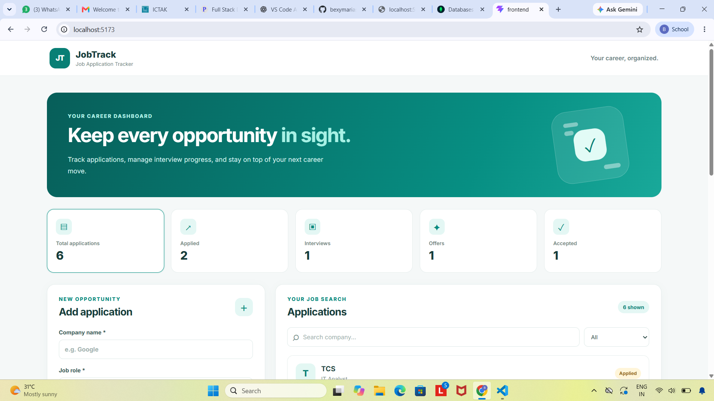
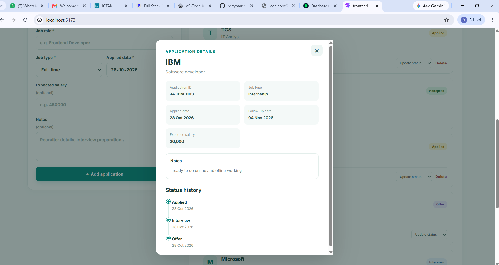

# JobTrack – Job Application Tracker

A MERN stack application for managing and tracking job applications.

## Technologies Used

- MongoDB and Mongoose
- Express.js
- React.js
- Node.js
- CSS

## Features

- Add, view, edit and delete job applications
- Automatic application ID generation
- Job types: Full-time, Internship and Contract
- Application status workflow and history timeline
- Automatic follow-up date (Applied Date + 7 days)
- Overdue follow-up indication
- Company search and status filtering
- Dashboard with application counts
- Applied Date and Application ID cannot be edited after creation
- Duplicate active application prevention
- Restrictions on deleting Interview and Offer applications

## Status Workflow

- Applied → Interview or Rejected
- Interview → Offer or Rejected
- Offer → Accepted or Declined
- Accepted, Rejected and Declined are final statuses.

## Installation and Setup

### Backend

```bash
cd backend
npm install
npm run dev
```

Backend runs at `http://localhost:5000`.

### Frontend

Open another terminal:

```bash
cd frontend
npm install
npm run dev
```

Frontend runs at `http://localhost:5173`.

## API Endpoints

| Method | Endpoint | Description |
|---|---|---|
| GET | `/api/applications` | Retrieve applications |
| POST | `/api/applications` | Create an application |
| GET | `/api/applications/summary` | Retrieve dashboard counts |
| GET | `/api/applications/:id` | Retrieve application details |
| PUT | `/api/applications/:id` | Edit permitted application fields |
| PATCH | `/api/applications/:id/status` | Update application status |
| DELETE | `/api/applications/:id` | Delete a permitted application |

The GET applications endpoint supports `company` and `status` query parameters.

## Screenshots

### 1. JobTrack Dashboard



### 2. Application Status Timeline


